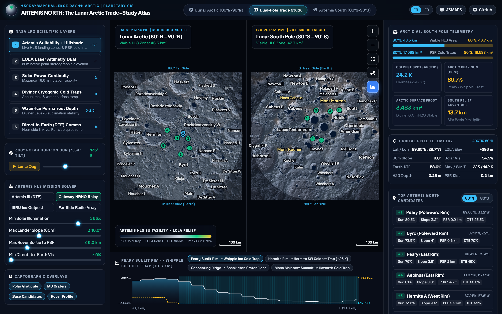
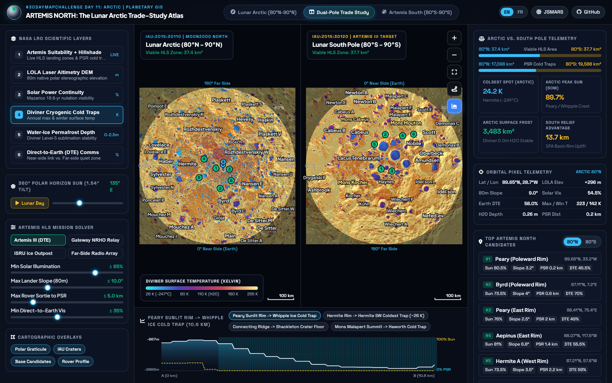
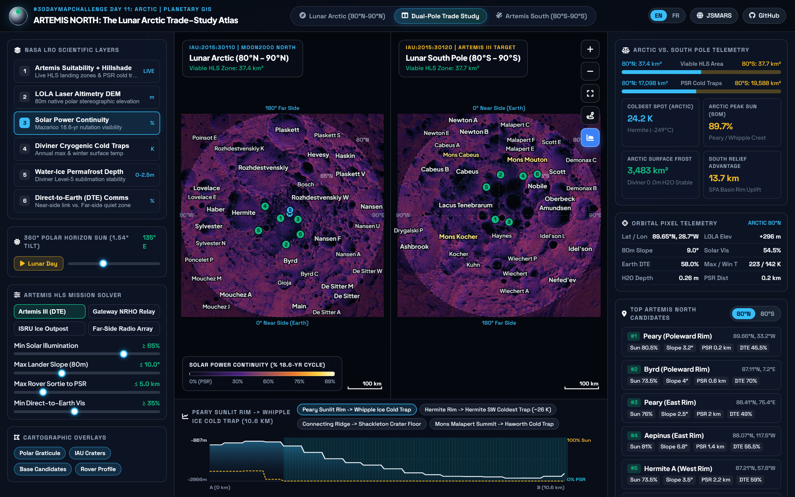

# Artemis North: The Lunar Arctic vs. South Pole Mission Trade-Study Atlas

> **#30DayMapChallenge | Day 11: Arctic**  
> **Live Interactive WebGIS:** [https://sounny.github.io/lunarmap/](https://sounny.github.io/lunarmap/)  
> **Companion Planetary Platform:** [JSMARS (https://jsmars.sounny.com)](https://jsmars.sounny.com)



## Why Map the Lunar Arctic for Artemis?

Every candidate landing zone for **NASA's Artemis III** crewed mission sits at the **Lunar South Pole** (`84°S to 90°S`). Yet the Moon has a second polar frontier: the **Lunar Arctic** (`80°N to 90°N`), home to over **600 million metric tons** of water ice (Spudis et al., 2010), four near-continuous sunlit peaks along **Peary Crater**, and the coldest temperatures ever measured in the Solar System inside **Hermite Crater** (`~24.2 K to 26 K` / `-247°C`, colder than the surface of Pluto).

**Artemis North** is a zero-dependency, browser-native planetary GIS and real-time aerospace trade-study solver built on **100% empirical NASA Lunar Reconnaissance Orbiter (LRO)** orbital datasets. Dragging any mission engineering constraint updates landing-zone suitability at 60 FPS across **both** the Lunar Arctic (`IAU:2015:30110`) and the Lunar South Pole (`IAU:2015:30120`) at identical scale (`+/- 304 km`, `1024 x 1024` grids).

---

## Empirical Polar Comparison (`80° to 90°` Cap, Derived from NASA PDS Grids)

| Metric (Poleward of `80°` Latitude) | Lunar Arctic (`80°N - 90°N`) | Lunar South Pole (`80°S - 90°S`) | Physical & Mission Significance |
| :--- | :---: | :---: | :--- |
| **Permanently Shadowed Regions (PSRs)** | `17,098 km²` | `19,588 km²` | South Pole holds `+14.6%` more permanent cold-trap area (`120m` Mazarico grid). |
| **Surface Water-Ice Frost Stability (`0.0 m`)** | `3,483 km²` | `4,615 km²` | South Pole holds `+32.5%` more area where exposed `H2O` frost resists sublimation (`Diviner PRP`). |
| **Peak Solar Continuity (`60m` Crest)** | **`89.7%`** | `88.4%` | Peary / Whipple polar crests rival Shackleton's Connecting Ridge across the 18.6-yr nutation cycle. |
| **Coldest Diviner PRP Annual Avg Temp** | **`24.2 K (-249°C)`** | `25.1 K (-248°C)` | Secondary cold traps inside Hermite Crater reach the lowest temperatures in the Solar System. |
| **LOLA Elevation Range (`rel. 1737.4 km`)** | `-5,004 m` to `+2,362 m` | `-6,664 m` to `+7,012 m` | The ancient 2,500 km **South Pole-Aitken (SPA) Basin** uplifted South Polar massifs nearly `2x` higher (`13.7 km` vs `7.4 km` span). |
| **Viable Artemis III Baseline (`DTE >= 35%`)** | `36.0 km²` | `37.0 km²` | Comparable high-illumination, low-slope (`<=10°`) pad area within `5 km` of a PSR cold trap. |

---

## Interactive Capabilities

1. **6 Real-Time NASA LRO Scientific Layers (Keys `1` to `6`):**
   - `[1]` **Artemis HLS Suitability + Dynamic Hillshade:** Highlights every polar cell satisfying live solar, slope, rover sortie, and Earth-link gates.
   - `[2]` **LOLA Laser Altimetry DEM (`m`):** `80 m/px` native polar stereographic elevation (`LDEM_80N_80M` & `LDEM_80S_80M`).
   - `[3]` **Solar Power Continuity (`%`):** Long-term solar visibility across the 18.6-year lunar nutation cycle (`60 m/px` inner core + `120 m/px` regional).
   - `[4]` **Diviner Cryogenic Cold Traps (`Kelvin`):** Annual maximum and winter bolometric surface temperatures (`LRO-L-DLRE-5-PRP-V2.0`).
   - `[5]` **ISRU Water-Ice Permafrost Depth (`0.0 m` to `2.5 m`):** Sublimation stability depth distinguishing exposed surface frost (`0.00 m`) from drillable regolith permafrost.
   - `[6]` **Direct-to-Earth (DTE) Communications Visibility (`%`):** Near-side Earth horizon access vs. the far-side radio-quiet zone.
2. **360° Polar Horizon Sun Simulator (`1.54°` Axial Tilt):** Sweep the grazing solar azimuth `360°` around the horizon or animate a full `29.53-day` lunar synodic cycle at 60 FPS.
3. **4 Mission Architecture Presets:** Switch instantly between **Artemis III (DTE)**, **Gateway NRHO Relay**, **ISRU Ice Outpost**, and **Far-Side Radio Array**.
4. **Interactive 2-Point Rover Transect Profiler:** Inspect curated traverses (*Peary Sunlit Rim -> Whipple Ice Cold Trap*, *Hermite Rim -> Coldest Trap*, *Connecting Ridge -> Shackleton Floor*) or draw custom 2-point cross-sections.
5. **Bilingual `EN / FR` Interface:** Full English and French translation parity.

| Diviner Cryogenic Cold Traps (`K`) | Solar Power Continuity (`%`) |
| :---: | :---: |
|  |  |

---

## Ground-Truth Data Provenance & Reproducibility

Zero synthetic values or mock datasets are used. Every raster pixel is built directly from archived NASA Planetary Data System (PDS) and USGS Astrogeology products via [`scripts/build_lunar_polar_atlas.py`](scripts/build_lunar_polar_atlas.py):

- **Topography & Slope:** Smith, D.E., et al. (2010). *Initial observations from the Lunar Orbiter Laser Altimeter (LOLA)*. Geophys. Res. Lett., 37, L18204. (`LDEM_80N_80M`, `LDEM_80S_80M`, NASA PDS).
- **Polar Illumination & PSRs:** Mazarico, E., Neumann, G.A., Smith, D.E., Zuber, M.T., & Torrence, M.H. (2011). *Illumination conditions of the lunar polar regions using LOLA topography*. Icarus, 211(2), 1066-1081. (`AVGVISIB_85N_060M`, `AVGVISIB_75N_120M`, `LPSR_85N_060M`, NASA GSFC PGDA Product #69).
- **Thermal & Ice Stability:** Paige, D.A., et al. (2010). *Diviner Lunar Radiometer observations of cold traps in the Moon's south polar region*. Science, 330(6003), 479-482. (`LRO-L-DLRE-5-PRP-V2.0`, UCLA / WUSTL PDS Geosciences Node).
- **North Polar Radar Ice Context:** Spudis, P.D., et al. (2010). *Initial results for the north pole of the Moon from Mini-SAR, Chandrayaan-1 mission*. Geophys. Res. Lett., 37, L06204.
- **Planetary Nomenclature:** International Astronomical Union (IAU) / USGS Astrogeology Gazetteer of Planetary Nomenclature (`ms:MOON_POINT` WFS, `LOLA 2011` control network).

### Local Quickstart & Rebuild

```bash
# Serve the static WebGIS locally (zero build step required)
python -m http.server 8080

# Optional: Rebuild all lossless PNG data grids from raw NASA PDS / PGDA archives
pip install numpy scipy tifffile pillow
python scripts/build_lunar_polar_atlas.py
```

---

## Author & License

Created by **Dr. Moulay Anwar Sounny-Slitine** ([sounny.com](https://sounny.com)), Assistant Professor of Earth Observation, GNSS, and GeoAI at the International Space University (ISU).  
Released under the [MIT License](LICENSE).
