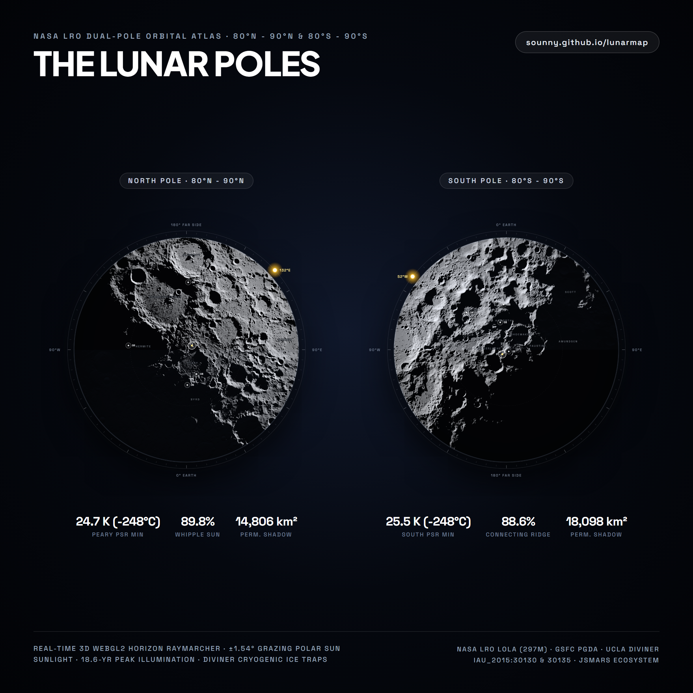
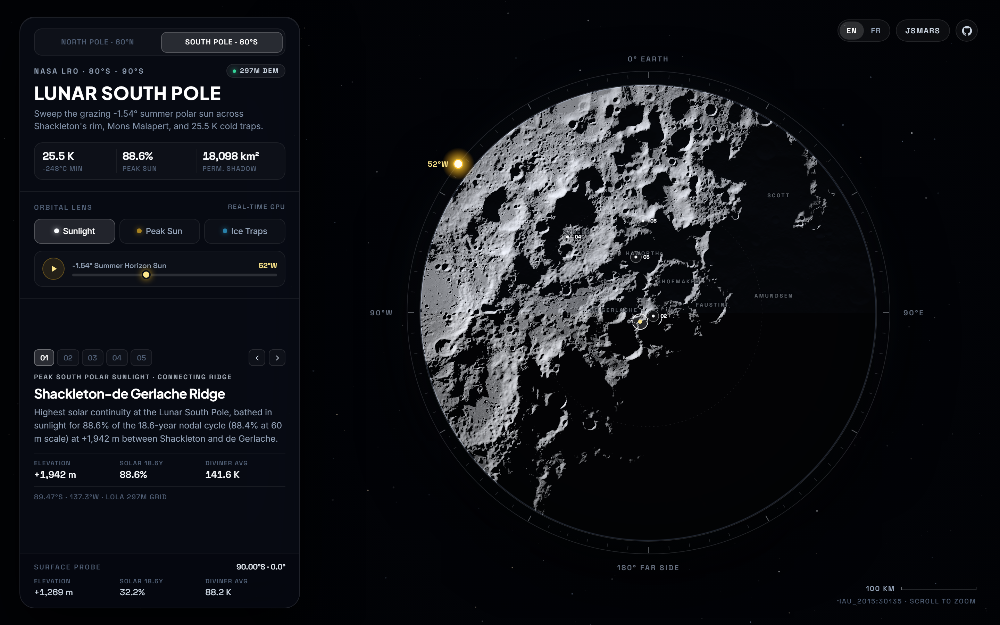

# Lunar Polar Atlas (North 80°N-90°N & South 80°S-90°S) · Real-Time NASA LRO WebGL2

> **Real-Time Dual-Pole WebGL2 Planetary Cartography · NASA LRO LOLA, GSFC PGDA & Diviner**  
> **Live Interactive Experience:** [https://sounny.github.io/lunarmap/](https://sounny.github.io/lunarmap/)  
> **Planetary WebGIS Ecosystem:** [JSMARS (https://jsmars.sounny.com)](https://jsmars.sounny.com)



## Overview

**Lunar Polar Atlas** is a vanilla WebGL2 (zero JavaScript library dependencies) GPU-raymarched planetary atlas covering **both** the Moon's **North Pole (`80°N to 90°N`, `IAU_2015:30130`)** and **South Pole (`80°S to 90°S`, `IAU_2015:30135`)**, built directly from empirical **NASA Lunar Reconnaissance Orbiter (LRO)** orbital datasets.

Because the lunar equator is inclined by only **1.54°** to the ecliptic (compared to Earth's 23.4°), sunlight at the lunar poles never rises high overhead. At polar summer solstice (`+1.54°` in the North, `-1.54°` in the South), the Sun skims horizontally **360° around the horizon**, casting hundred-kilometer crater shadows across cryogenic depressions while bathing narrow crater rims in quasi-continuous sunlight.

Switch seamlessly between **North Pole · 80°N** and **South Pole · 80°S**, and drag the **360° Orbital Sun Ring** (or press **Play**) to raymarch live lunar shadows across **2048 × 2048** (`296.9 m/px`) 16-bit LOLA elevation grids directly in WebGL2.

---

## North Pole vs. South Pole Empirical Benchmarks (`|lat| ≥ 80°`)

| Benchmark | North Pole (`80°N - 90°N`, `IAU_2015:30130`) | South Pole (`80°S - 90°S`, `IAU_2015:30135`) |
| :--- | :--- | :--- |
| **Diviner Annual Mean Minimum** | **`24.7 K (-248°C)`** (`24.4 K` raw facet in Peary PSR) | **`25.5 K (-248°C)`** (`25.2 K` raw facet; `26.3 K` Haworth floor) |
| **Peak Polar Sunlight (18.6 yr)** | **`89.8%`** (`89.7%` at `60 m`, Whipple North Rim) | **`88.6%`** (`88.4%` at `60 m`, Shackleton-de Gerlache Ridge) |
| **Permanent Shadow Area** | **`14,806 km²`** (`593.8 m` grid; `16,994 km²` at `120 m`) | **`18,098 km²`** (`593.8 m` grid; `19,475 km²` at `120 m`) |
| **Thermally Stable Surface Frost** | **`1,631 km²`** (`ice_depth = 0.00 m`) | **`2,226 km²`** (`ice_depth = 0.00 m`, incl. Cabeus LCROSS basin) |
| **LOLA Elevation Range (`R = 1,737.4 km`)** | **`-5,042 m` to `+2,371 m`** (`0.13 m` 16-bit step) | **`-6,674 m` to `+7,023 m`** (`0.23 m` 16-bit step) |

---

## Three Empirical Orbital Lenses

| Lens | Physical Phenomenon | Empirical NASA Source & Grid Resolution |
| :--- | :--- | :--- |
| **Sunlight** | Real-time **40-step** 3D spherical horizon raymarching (`±1.54°` summer horizon sun) with `0.53°` solar-disc penumbra, near-side-only Earthshine, and Lommel-Seeliger (`2μ₀ / (μ₀ + μ)`) lunar reflectance with sRGB gamma transfer. | LRO LOLA `LDEM_80N_80M` & `LDEM_80S_80M` (`80 m/px` source, `0.5 m` `int16` step; block-averaged to **`296.9 m/px`**, 16-bit RG PNG) |
| **Peak Sun** | Highlights narrow polar crests along **Whipple / Peary** (North, up to `89.8%`) and the **Shackleton-de Gerlache Connecting Ridge** (South, up to `88.6%`) across the **18.6-year lunar nodal precession cycle**. | NASA GSFC PGDA Product #69 (2016): `AVGVISIB_85N/85S_060M_201608` (`60 m/px`) & `AVGVISIB_75N/75S_120M_201608` (`120 m/px`) |
| **Ice Traps** | Maps cryogenic cold-trap terrain (`Tavg ≤ 110 K`) and thermally stable surface water frost (`ice_depth = 0.00 m`) across permanently shadowed regions (`14,806 km²` North, `18,098 km²` South). | Paige, Sullivan & Williams (2018) UCLA Diviner Level-5 `LRO-L-DLRE-5-PRP-V2.0` (`dlre_prp_north` & `dlre_prp_south`, **`593.8 m/px`**) |

| North Pole (`80°N - 90°N` Sunlight) | South Pole (`80°S - 90°S` Sunlight) |
| :---: | :---: |
|  |  |

| Peak Polar Sunlight (`88.6% - 89.8%`) | Cryogenic Cold Traps (`24.7 K - 25.5 K`) |
| :---: | :---: |
|  |  |

---

## Data Provenance & Integrity

All interface readouts, landmarks, and shaders derive directly from empirical orbital grids (no placeholder HTML numbers, no procedural noise, no synthetic elevation albedo, and official IAU / USGS Gazetteer crater coordinates):

- **Laser Altimetry:** Smith, D. E., et al. (2010). *Initial observations from the Lunar Orbiter Laser Altimeter (LOLA)*. *Geophys. Res. Lett.*, 37, L18204 (`LRO-L-LOLA-4-GDR-V1.0`, `LDEM_80N_80M` & `LDEM_80S_80M`).
- **Solar Continuity & PSRs:** NASA GSFC Planetary Geodesy Data Archive (PGDA) **Product #69** (*Lunar Polar Illumination*, 2016: `AVGVISIB_85N/85S_060M_201608`, `AVGVISIB_75N/75S_120M_201608`, `LPSR_75N/75S_120M_201608`), following Mazarico, E., et al. (2011), *Illumination conditions of the lunar polar regions using LOLA topography*, *Icarus*, 211(2), 1066-1081.
- **Cryogenic Temperatures & Water-Ice Stability:** Paige, D. A., et al. (2010), *Diviner Lunar Radiometer observations of cold traps in the Moon's south polar region*, *Science*, 330(6003), 479-482; Colaprete, A., et al. (2010), *Detection of water in the LCROSS ejecta plume*, *Science*, 330(6003), 463-468; Paige, D. A., Sullivan, M. T., & Williams, J.-P. (2018), *LRO DLRE Level 5 Polar Resource Products V2.0* (`LRO-L-DLRE-5-PRP-V2.0`), NASA PDS (`doi:10.17189/wj0s-w188`); and Williams, J.-P., et al. (2019), *Seasonal polar temperatures on the Moon*, *J. Geophys. Res.: Planets*, 124(10), 2505-2521.
- **Planetary Nomenclature:** International Astronomical Union (IAU) Working Group for Planetary System Nomenclature / USGS Astrogeology Gazetteer of Planetary Nomenclature (`IAU_2015:30130` & `IAU_2015:30135`).

```bash
# Run locally with any static HTTP server (zero build step)
python -m http.server 8080
```

## Author & License

Created by **Dr. Moulay Anwar Sounny-Slitine** ([sounny.com](https://sounny.com)), Assistant Professor of Earth Observation, GNSS, and GeoAI at the International Space University (ISU).  
Released under the [MIT License](LICENSE).
