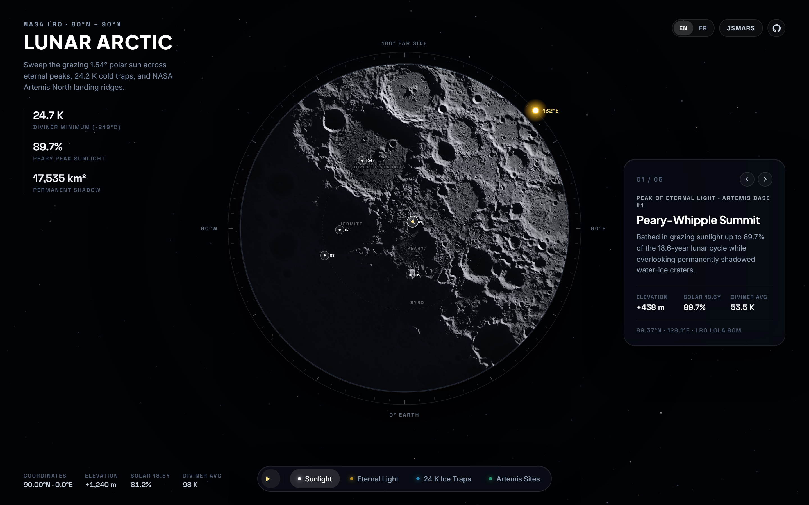
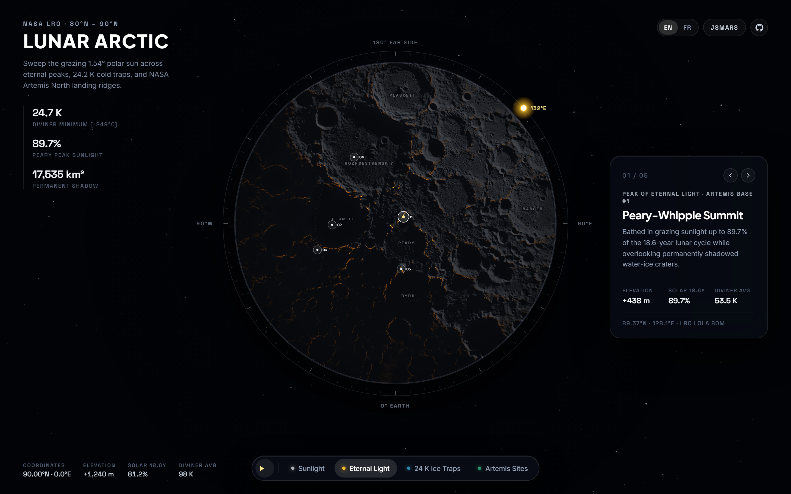
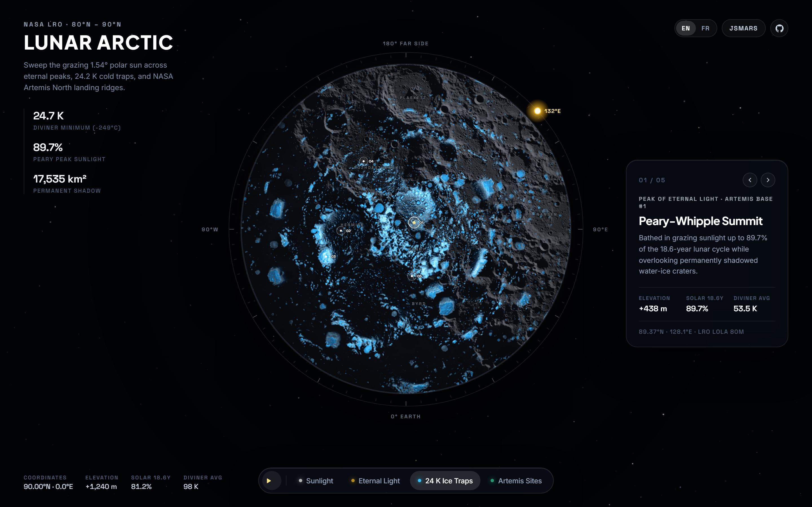

# Lunar Arctic (80°N – 90°N) · Real-Time NASA LRO Orbital Atlas

> **#30DayMapChallenge · Day 11: Arctic**  
> **Live Interactive Experience:** [https://sounny.github.io/lunarmap/](https://sounny.github.io/lunarmap/)  
> **Planetary WebGIS Ecosystem:** [JSMARS (https://jsmars.sounny.com)](https://jsmars.sounny.com)



## Overview

**Lunar Arctic** is a zero-dependency, GPU-raymarched planetary atlas of the Moon's North Pole (`80°N to 90°N`, `IAU:2015:30110` North Polar Stereographic) built directly from empirical **NASA Lunar Reconnaissance Orbiter (LRO)** orbital datasets.

Because the Moon's spin axis tilts only **1.54°** relative to the ecliptic (compared to Earth's 23.4°), sunlight at the Lunar North Pole never rises high overhead. Instead, the Sun skims horizontally **360° around the horizon**, casting hundred-kilometer razor-sharp crater shadows across deep cryogenic basins while bathing narrow mountain rims in near-eternal light.

Drag the **360° Orbital Sun Ring** (or press **Play**) to raymarch live lunar shadows across **2048 × 2048** 16-bit LOLA laser altimetry at 60 FPS directly in WebGL2.

---

## Four Orbital Scientific Lenses

| Lens | Physical Phenomenon | Empirical NASA Source |
| :--- | :--- | :--- |
| **Sunlight** | Real-time 52-step 3D spherical horizon raymarching with `0.53°` solar-disc penumbra and Lommel-Seeliger lunar regolith reflectance. | LRO LOLA `LDEM_80N_80M` (`80 m/px`, `0.13 m` 16-bit vertical precision) |
| **Eternal Light** | Highlights narrow polar crests along **Peary** and **Whipple** craters that remain sunlit up to **89.7%** of the 18.6-year lunar nutation cycle. | Mazarico et al. (2011) `AVGVISIB_85N_060M` & `75N_120M` |
| **24 K Ice Traps** | Reveals **17,098 km²** of permanently shadowed cold traps and **3,483 km²** of thermally stable surface water frost down to **~24.2–26 K (-249°C to -247°C)**, colder than Pluto. | Paige et al. (2010) UCLA Diviner Level-5 `LRO-L-DLRE-5-PRP-V2.0` |
| **Artemis Sites** | Live multi-criteria landing-zone solver isolating flat (`≤8°`), continuously sunlit (`≥72%`) ridges within rover range (`≤3.5 km`) of water-ice cold traps for a future **Artemis North** outpost. | Coupled LOLA Slope + Mazarico Illumination + PSR Proximity |

| Eternal Light (`89.7%` Peak) | 24 K Cryogenic Ice Traps |
| :---: | :---: |
|  |  |

---

## Data Provenance & Local Reproduction

Zero mock values or synthetic heightfields are used:

- **Laser Altimetry:** Smith, D.E., et al. (2010). *Initial observations from the Lunar Orbiter Laser Altimeter (LOLA)*. Geophys. Res. Lett., 37, L18204 (`LDEM_80N_80M`).
- **Solar Continuity & PSRs:** Mazarico, E., et al. (2011). *Illumination conditions of the lunar polar regions using LOLA topography*. Icarus, 211(2), 1066-1081 (NASA GSFC PGDA Product #69).
- **Cryogenic Temperatures & Ice Depth:** Paige, D.A., et al. (2010). *Diviner Lunar Radiometer observations of cold traps in the Moon's polar regions*. Science, 330(6003), 479-482 (`LRO-L-DLRE-5-PRP-V2.0`).
- **Radar Water-Ice Context:** Spudis, P.D., et al. (2010). *Initial results for the north pole of the Moon from Mini-SAR, Chandrayaan-1 mission*. Geophys. Res. Lett., 37, L06204.

```bash
# Run locally with any static HTTP server (zero build step)
python -m http.server 8080
```

## Author & License

Created by **Dr. Moulay Anwar Sounny-Slitine** ([sounny.com](https://sounny.com)), Assistant Professor of Earth Observation, GNSS, and GeoAI at the International Space University (ISU).  
Released under the [MIT License](LICENSE).
